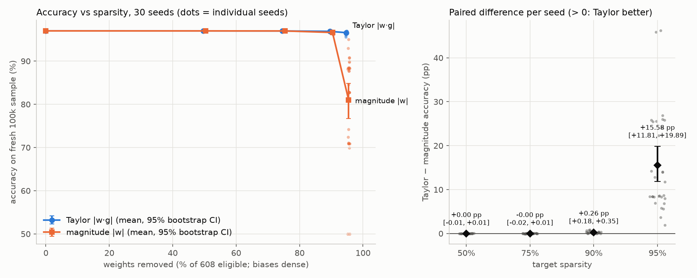

# Pruning evidence: sparsity sweep, real cost, magnitude baseline

Everything here is produced by one command (≈4 min on 8 cores):

```
python -m pytrainer.experiments.sweep --out-dir results/sweep                      # seeds 0–29
python -m pytrainer.experiments.sweep --first-seed 30 --out-dir results/sweep_replication  # seeds 30–59
```

| file | contents |
|---|---|
| `runs.csv` | one row per training run (270 runs): accuracy, loss, kept weights, MAC counts, compacted shape |
| `summary.csv` | per (criterion, sparsity): mean accuracy, 95% bootstrap CI, SD, worst seed |
| `comparison.csv` | paired Taylor − magnitude differences per sparsity, with tests |
| `cost.csv` | wall-clock µs/sample of three forward paths |
| `pareto.png` | accuracy vs sparsity (left), paired per-seed difference (right) |

## Setup

- **Task / model:** two moons (2,000 samples, noise 0.2), 2-32-16-2 ReLU MLP. The 608 weights can be pruned; the 50 biases stay dense.
- **Schedule** (`prune_mlp.py`): 10 dense warm-up epochs, then pruning after every epoch along a cubic schedule until the target is reached at epoch 80, then 20 fine-tuning epochs. The model kept is the epoch with the lowest validation loss after the target is reached.
- **Criteria:**
  - **Taylor |w·g|:** each weight's score is a running (exponential) average of |weight × gradient|, measured on every minibatch.
  - **Magnitude |w|:** global magnitude pruning. Everything else is identical: the same data, split, initialization, batch order, schedule and safeguards. Each seed is therefore a **paired** comparison.
- **Safeguards:** each layer keeps at least 2% of its weights, and each output unit keeps at least one input. The default 5% floor would keep 32 weights, but 95% sparsity allows only 30, so the whole sweep uses 2% for both criteria. At ≤ 90% the safeguards never fired for either criterion (`safeguard_kept_max` = 0).
- **Accuracy** is measured two ways:
  - On the 300-sample test split.
  - On a **fresh 100,000-sample** draw from the same distribution, standardized with each run's training statistics. Its evaluation noise is about 0.05 pp per model, so differences reflect the models, not test-set luck.
- **Seeds:** 30 (0–29), plus 30 held-out seeds (30–59) for the replication below. A seed fixes the dataset draw, the split, the initialization and the batch order.

## 1. Sparsity–accuracy curve



| sparsity | criterion | kept / 608 | fresh-100k acc % (95% CI) | worst seed % | test-300 acc % |
|---|---|---|---|---|---|
| 0% | dense | 608 | 97.00 (96.97–97.02) | 96.79 | 96.98 |
| 50% | Taylor | 304 | 96.99 (96.97–97.01) | 96.78 | 96.96 |
| 50% | magnitude | 304 | 96.99 (96.97–97.01) | 96.82 | 97.00 |
| 75% | Taylor | 152 | 96.98 (96.95–97.00) | 96.84 | 96.97 |
| 75% | magnitude | 152 | 96.98 (96.96–97.00) | 96.86 | 96.94 |
| 90% | Taylor | 61 | 96.89 (96.85–96.92) | 96.66 | 96.82 |
| 90% | magnitude | 61 | 96.62 (96.55–96.70) | 96.09 | 96.54 |
| 95% | Taylor | 30 | 96.58 (96.46–96.69) | 95.58 | 96.56 |
| 95% | magnitude | 30 | 81.00 (76.69–84.81) | **50.00** | 81.40 |

Achieved sparsity equals the target to within one weight (the budget is an exact count of weights). Up to 75% sparsity neither criterion loses measurable accuracy: this task is easy for a 608-weight network.

## 2. Cost: what actually got cheaper

**The training-time forward pass does not count.** `Linear` computes `x @ (W * M)`: a dense matmul in which pruned weights are multiplied by zero. That costs exactly as much as the dense model, at every sparsity. It appears below as `dense_with_zeros` for reference. Training cost is not reduced at all.

`nn/sparse.py` has two inference paths that skip pruned work. Every run checks that both produce the same logits as the trained model; the worst difference over all 540 runs is 7e-15.

- **`SparseLayer`** (written for this, CSC layout): stores only the kept connections and performs exactly one multiply-add per kept connection per sample.
- **`compact`:** deletes hidden units that pruning disconnected. A unit with no outgoing weights is dropped; a unit with no incoming weights outputs a constant, which is folded into the next layer's bias. The result is a smaller *dense* network.

**Multiply-adds per sample** (weights only; biases and ReLU excluded), mean over 30 seeds:

| sparsity | dense | Taylor: sparse path | Taylor: compacted dense | magnitude: compacted dense |
|---|---|---|---|---|
| 50% | 608 | 304 | 558 | 582 |
| 75% | 608 | 152 | 392 | 445 |
| 90% | 608 | 61 (10.0× fewer) | 145 (4.2× fewer) | 106 |
| 95% | 608 | 30 (20.3× fewer) | 59 (10.3× fewer) | 13 (broken networks, see §3) |

**Wall-clock**, single thread, seed-0 Taylor model, best of 5 repeats (µs per sample; speedup is relative to `dense_with_zeros`):

| sparsity | batch | dense-with-zeros | sparse path | compacted dense | sparse speedup | compacted speedup |
|---|---|---|---|---|---|---|
| 0% | 100,000 | 0.311 | 15.5 | 0.282 | 0.02× | 1.10× |
| 90% | 1 | 8.45 | 27.9 | 8.13 | 0.30× | 1.04× |
| 90% | 256 | 0.205 | 0.671 | 0.116 | 0.30× | **1.76×** |
| 90% | 100,000 | 0.237 | 1.11 | 0.094 | 0.21× | **2.52×** |
| 95% | 256 | 0.207 | 0.504 | 0.0929 | 0.41× | **2.22×** |
| 95% | 100,000 | 0.234 | 0.747 | 0.0625 | 0.31× | **3.74×** |

The full grid is in `cost.csv`. What this shows:

- **The sparse path does 10× fewer multiply-adds at 90% sparsity, but it is 3–5× *slower* than the dense matmul at every batch size measured.** At 608 weights the dense matmuls are tiny and vectorized. The sparse path pays for gathering inputs into an N × nnz array, irregular memory access and extra NumPy calls. Fewer FLOPs did not mean less time at this scale, so I don't claim a speedup from it.
- **Compaction gives a real speedup**: 1.8× at batch 256 and 2.5× at batch 100k for 90% sparsity. The pruned model really is a smaller dense network (typically 2-14-7-2 instead of 2-32-16-2).
- **At batch size 1 nothing helps** (all ≈ 8 µs): the cost is Python and NumPy call overhead, not arithmetic.
- **Timing noise:** `dense_with_zeros` has the same shapes at every sparsity, yet ranges from 0.23 to 0.31 µs/sample at batch 100k. Treat speedups below about 1.2× as noise.

## 3. Baseline: Taylor vs magnitude, and is it noise?

Differences are paired by seed, as Taylor − magnitude. CIs are percentile bootstrap over seeds, because the 95% results are far from normal.

| sparsity | Taylor | magnitude | paired diff (95% CI) | Taylor / tie / magnitude wins | Wilcoxon p |
|---|---|---|---|---|---|
| 50% | 96.99% | 96.99% | +0.00 pp (−0.01 to +0.01) | 14 / 0 / 16 | 0.86 |
| 75% | 96.98% | 96.98% | −0.00 pp (−0.02 to +0.01) | 16 / 0 / 14 | 0.74 |
| 90% | 96.89% | 96.62% | **+0.26 pp (+0.18 to +0.35)** | 25 / 0 / 5 | 7e-7 |
| 95% | 96.58% | 81.00% | **+15.6 pp (+11.8 to +19.9)** | 30 / 0 / 0 | 2e-9 |

(Fresh-100k accuracy. Test-300 accuracy and fresh-sample loss are in `comparison.csv`. At 90%, Taylor has the lower loss in 30 of 30 seeds.)

**Why the 90% difference is not noise:**

- **Evaluation noise is negligible.** On 100k samples a single model's accuracy has a standard error of about 0.05 pp, and both criteria are scored on the *same* sample. On the 300-sample split it is about 1 pp per model, four times the effect. That is why the same comparison on test-300 is much noisier: +0.28 pp, CI +0.06 to +0.50, 8 ties, p = 0.02.
- **Seed-to-seed variation is the real noise.** At 90% the SD across seeds is 0.10 pp for Taylor and 0.21 pp for magnitude, and the SD of the paired difference is 0.25 pp. With 30 seeds the mean difference (+0.26 pp) is about 6 standard errors from zero.
- **Multiple comparisons:** 4 sparsity levels × 3 metrics = 12 tests. The 90% fresh-accuracy result (p = 7e-7) survives Bonferroni (0.05 / 12 = 0.004). The test-300 version (p = 0.02) would not on its own.
- **Replication on 30 new seeds (30–59)**, run after the claim below was written (`results/sweep_replication/`):
  - At 90%, Taylor is better in **29 / 30** seeds; Wilcoxon p = 4e-9.
  - The median paired difference is **+0.225 pp, the same as in the original 30 seeds** (+0.225 pp).
  - The mean is larger, +0.53 pp (CI +0.19 to +1.13), because one magnitude seed (seed 42) partly collapsed to 87.96%. Without that seed the mean is +0.24 pp. That outlier also makes the paired t-test non-significant (p = 0.076), while the rank test is unaffected.
  - At 95%, Taylor is better in 30 / 30 seeds (+11.0 pp).

**Why magnitude fails at high sparsity** (`compact_shape` in `runs.csv`):

- Global magnitude ranks each weight on its own. fc1 starts with the largest weights (He initialization with fan-in 2 has std 1.0, versus 0.25 for fc2), so magnitude keeps fc1 weights and cuts fc2 down to its 2% floor.
- The surviving weights then often don't connect into input-to-output paths. At 95% the effective networks are 2-1-1-2 or 2-2-2-2, and twice 2-0-0-2: no path from input to output, a constant prediction, exactly 50% accuracy.
- Taylor's |w·g| is close to zero for a weight on a dead path, because no gradient flows through it, so Taylor keeps connected paths: typically 2-8-4-2 at 95%.

## The claim

> **At 90% sparsity (61 of 608 weights kept), Taylor-saliency pruning reaches 96.89% accuracy on a fresh 100,000-sample test set versus 96.62% for global magnitude pruning, the mean over 30 paired seeds (0–29). The paired difference is +0.26 pp (95% bootstrap CI +0.18 to +0.35 pp), and Taylor is better in 25 of 30 seeds (Wilcoxon p = 7×10⁻⁷).**

Numbers: `summary.csv` and `comparison.csv`, rows `target_sparsity = 0.9`, metric `fresh_accuracy`.

**How to falsify it:** rerun with new seeds (`--first-seed N`). The claim is wrong if the paired difference at 90% is ≤ 0 or its CI includes 0, or if Taylor does not win a clear majority of seeds. On seeds 30–59 it held (29/30 wins, median +0.225 pp).

Note the size: Taylor keeps 99.9% of dense accuracy at 90% sparsity, magnitude 99.6%. A 0.26 pp gap is real but small on this task. The difference that matters in practice is at 95%, where magnitude breaks in every seed and Taylor does not.

## Limitations, stated plainly

- **One toy task and one small MLP.** Up to 75% sparsity both methods are at the dense ceiling, so the comparison only discriminates at 90%+.
- **The baseline is *global* magnitude** with the same gradual schedule and fine-tuning. Layer-wise magnitude pruning (uniform sparsity per layer) would probably avoid the layer collapse; it was not tested.
- **At 95% the 2% floor was active for magnitude** (up to 3 weights held). A larger floor might rescue magnitude, but the default 5% floor makes 95% impossible. The 90% comparison has no safeguard involvement.
- **One hyperparameter setting** (EMA decay 0.9, schedule 10→80, 100 epochs, Adam lr 1e-3). Neither method was tuned.
- **Wall-clock numbers are from NumPy on one CPU thread.** A compiled sparse kernel would behave differently. The compaction speedup needs no special kernel.
